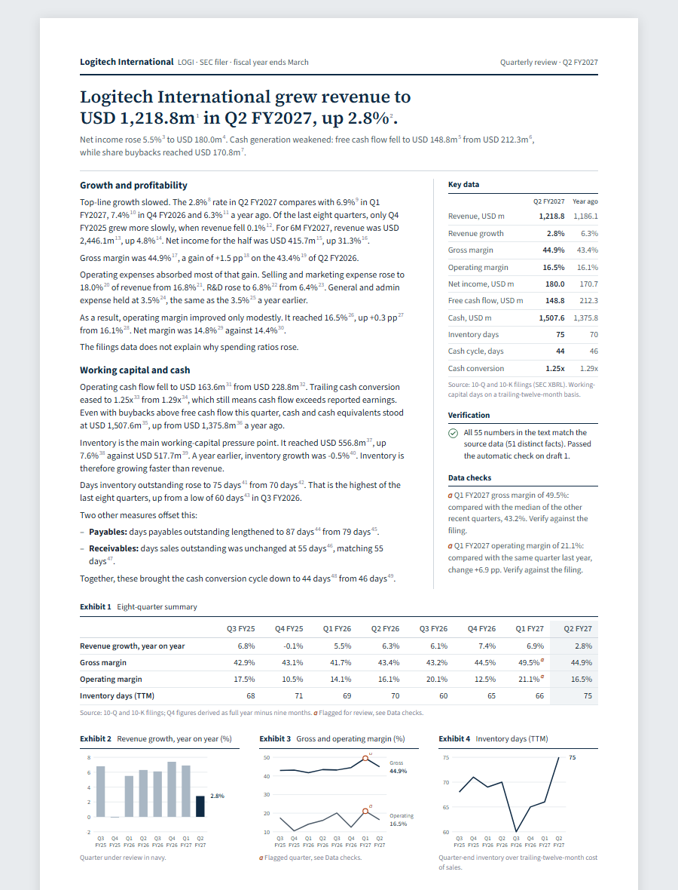
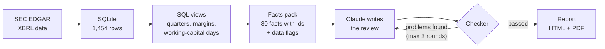

# Filings review: Quarterly review where every number is checked

One command turns a company's SEC filings into a three-page quarterly business review for a CFO.
Code does the arithmetic. Claude writes the commentary, and must cite a source fact behind every number.
A checker compares each number with its source and sends the draft back until it is right.
Only an approved draft becomes the report. First company: **Logitech (LOGI), Q2 FY2027** (July to September 2026).

[](output/report.pdf)

**[Read the full report (PDF, 3 pages)](output/report.pdf)**. In this run, 55 numbers in the text were matched to 51 facts, and the first draft passed the checker.

## Why it is built this way

An AI that writes about financial numbers will sometimes get a number wrong, and a wrong number in a
CFO pack costs more than the time saved. So the work is split:

| Who | Does what |
|---|---|
| Python and SQL | Download the filings, compute every figure (margins, growth, working-capital days) |
| Claude | Writes the commentary, using only the computed facts, each one cited by its id |
| A checker (plain code) | Compares every cited number with its fact; rejects the draft if anything is wrong |
| A person | Reads the approved review and signs it off. The checker catches wrong numbers, not wrong reasoning |

## How it works



| Step | File | What it does |
|---|---|---|
| 1 Download | `download.py` | Saves everything the company has filed with the SEC (XBRL "company facts") as a dated snapshot in `data/raw/` |
| 2 Load | `load.py`, `config.py`, `sql/schema.sql` | Takes 17 line items, removes duplicates (newest filing wins, so restatements replace old figures), loads them into SQLite |
| 3 Calculate | `sql/views.sql` | Turns year-to-date figures into single quarters (Q4 = full year minus nine months), then margins, year-on-year growth, trailing-twelve-month working-capital days |
| 4 Facts pack | `facts.py` | Writes the only numbers the AI may use, each with an id such as `cur.revenue`, already rounded as the report shows them; flags figures that look out of line |
| 5 Write | `commentary.py`, `prompts/system.md` | Sends the rules and the facts pack to Claude (Anthropic API) |
| 6 Check | `validate.py`, `review.py` | Checks the draft; sends the exact problems back for a rewrite, at most three rounds; saves every round in `output/validation_log.json` |
| 7 Report | `report.py`, `templates/report.html` | Lays out the approved review as a research note with exhibits, and prints the PDF |
| All | `run.py` | Runs steps 1 to 7 and stops at the first failure |

## The controls

- **Every number needs a source.** Each number Claude writes must be followed by a fact id, e.g. `USD 1,218.8m [F:cur.revenue]`. The checker rejects a number whose value differs from its fact, a fact id that does not exist, and any number with no id at all.
- **No new arithmetic by the AI.** All calculations happen in SQL and Python. The prompt forbids the model from adding, subtracting or averaging, and the checker rejects any figure it cannot trace.
- **Data flags must be reported.** When a figure looks out of line (Q1 FY2027 gross margin of 49.5% against a median of 43.2%), the review must mention it under Data caveats, and must not invent a reason for it.
- **Missing data stays missing.** A figure the filings do not provide is listed as missing, and the review must say so instead of estimating.
- **Structure and length.** Five sections in a fixed order, 450 to 650 words, at least 12 cited numbers, no placeholders.
- **A failed run leaves nothing behind.** If the draft still fails after three rounds, the old approved review is deleted, so a stale review can never be printed as if it were new.
- **The report checks again.** `report.py` re-checks the approved review against the current facts pack before printing. If the data changed since approval, it refuses.
- **Everything is recorded.** Each round's draft, problems found and token usage are saved in `output/validation_log.json`.

## What it does not catch (honest limits)

- **It checks numbers, not reasoning.** An early draft called inventory days of 75 "the highest level in the series". The number was right; the claim was wrong (it reached 106 days in March 2022, outside the eight quarters the AI was shown). The checker passed it, because the claim is in words. I fixed it in the prompt (rule 9: say "the highest of the last eight quarters"). That makes the mistake less likely, but does not rule it out. This is why a person signs off.
- **Some quarters are calculated, not reported.** Companies do not report Q4 on its own, and most cash-flow figures are reported only year to date. These quarters are derived by subtraction, and the report's method notes say so.
- **A flag is not an explanation.** The checker makes sure an unusual figure is reported; it cannot say why it happened.
- **One company so far.** Line items and the company ID live in `config.py`, but Logitech's March year-end is still written into `sql/views.sql` and the report template. A company with a different year-end needs those changed. Banks and insurers need different measures altogether (version 1 covers non-financial companies only).
- **The data is only as good as the company's tagging.** Logitech switched its revenue tag in 2018 and used a different net income tag from 2011 to 2021; `config.py` lists the alternatives for each line item.

## Three things that went wrong while building it

1. **A restated year.** In August 2013 Logitech filed an amended annual report that restated net income for the year to March 2011 from USD 128.46m to USD 131.17m. My first de-duplication rule kept the old figure. The rule is now "newest filing wins".
2. **A silent gap.** Net income was empty for 40 of 70 quarters, with no error anywhere, because Logitech used a different tag for ten years. A pipeline can run cleanly and still be wrong: you have to count what is empty, not only what fails. I added the second tag, and the facts pack now lists every missing figure by name.
3. **A checker that was too strict.** On its first real draft the checker rejected the phrase "Q4 figures" as an uncited number. I tuned it on real output and added a test so the fix stays fixed.

## Cost

About USD 0.11 per review on the runs I measured, with Claude Opus 5.5. The latest run passed in one round: about 8,100 input tokens (the rules and the facts pack, cached so that a second round costs less) and 3,300 output tokens.

## Run it yourself

Windows, Python 3.13. The PDF step uses Microsoft Edge in headless mode.

```powershell
git clone https://github.com/matifilo/filings-review.git
cd filings-review
python -m venv .venv
.venv\Scripts\python -m pip install -r requirements.txt
```

Two private files, both ignored by git:

- `.env` with one line: `ANTHROPIC_API_KEY=your-key` (needed for step 5 only)
- `sec_contact.txt` with your name and email: the SEC asks every automated request to identify itself (needed for step 1 only)

```powershell
.venv\Scripts\python run.py --no-download   # use the saved snapshot in data/raw
.venv\Scripts\python run.py                 # download fresh data from the SEC first
```

The result is `output/report.pdf`. To check a draft without calling the AI: `.venv\Scripts\python validate.py`.

## Tests

```powershell
.venv\Scripts\python -m pytest
```

13 tests check that the checker passes an approved review and catches each kind of mistake: a wrong number, a number that only ends the same way, an unknown fact id, a number with no source, a placeholder, missing or reordered sections, an unreported data flag, a review that is too short. They run on frozen copies of a real facts pack and review (`tests/fixtures/`), need no API key, and take under a second.

## About

Built by Mateusz Filochowski in November 2026, as a rebuild of an earlier prototype on Anker Innovations' Chinese filings. I designed each step and typed the code myself, with Claude as a coding tutor and reviewer; the git history shows the build phase by phase.
Data: SEC EDGAR, public domain. This is a portfolio project, not investment advice.

[LinkedIn](https://www.linkedin.com/in/mateuszfilochowski)